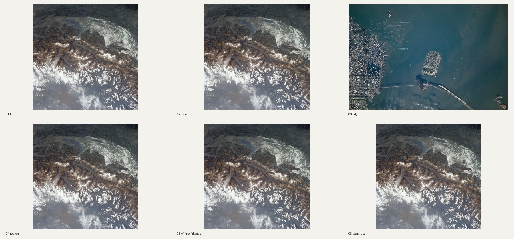

# Public example gallery

These are educational engineering demonstrations using real NASA aerial photography, not ground-level travel portfolio examples. No user private photo is included. The map is an independent regional locator, not a perspective-aligned annotation or the astronaut's camera GPS.



Reproduce offline from the repository root:

```bash
pip install '.[terrain,repair]'
python examples/build_examples.py --output render-output/examples
```

The committed `generated/` tree contains full-resolution final PNGs, editable overlays and manifests for six scenarios, plus a serial two-photo batch. Source originals stay in `data/`. The gallery alone uses resized previews; final render dimensions match the normalized source. Synthetic text was deliberately added to a public source image solely to demonstrate reviewed-mask interpolation. It is not represented as original photographic content.

| Scenario | Actual data |
|---|---|
| Lake | Lake Lucerne / Natural Earth Europe lakes 5.0.0, minimum map span 60km |
| Mountains | N46E008 Mapzen/Tilezen real DEM subset, computed 400m contours |
| City | Actual OSM San Francisco roads, place-level center |
| Regional | Same verified lake, open area locator ring, optional labels disabled |
| Data failure | Offline uncached geographic lookup → unchanged clean photograph |
| Old text | Deliberately added test text + reviewed local repair mask |
| Batch | Two public image copies, serial offline pipeline |

## Photography rights

`data/photos.sources.json` preserves catalog descriptions, canonical pages, URLs and file hashes. NASA images are used factually for educational documentation, with NASA acknowledged; this does not imply endorsement. Read [NASA media guidelines](https://www.nasa.gov/nasa-brand-center/images-and-media/) before other uses. NASA occasionally distributes third-party material: these two catalog entries credit NASA and contain no third-party copyright notice in the retrieved catalog metadata.

- `lake_photo.jpg`: NASA / Skylab 3 crew, SL3-121-2438 (1973), handheld Hasselblad photograph of the Alps and lakes including Lucerne; [catalog](https://images.nasa.gov/details/sl3-121-2438).
- `city_photo.jpg`: NASA / Expedition 22 crew, ISS022-E-050559 (2010), San Francisco Bay / Treasure Island and Alcatraz; [catalog](https://images.nasa.gov/details/iss022e050559).

Photography and derived example artwork are not relicensed under the project's MIT software license. The factual NASA photograph remains a separate source; the overlay is produced locally by deterministic code. No generative image model is used.

## Geographic rights and extraction

`lucerne.geojson`: actual lake polygon from [Natural Earth Europe lakes](https://github.com/nvkelso/natural-earth-vector/blob/master/geojson/ne_10m_lakes_europe.geojson), version 5.0.0, public domain. Only properties are normalized; geographic geometry is retained. `ne_id` identifies the upstream feature. The source hash describes the downloaded full upstream collection.

`san_francisco.geojson`: 580 ways from a bounded Overpass request, ODbL. © OpenStreetMap contributors; [copyright/license](https://www.openstreetmap.org/copyright). The included extract remains ODbL and is not MIT. Preserve per-way OSM IDs/links, snapshot and attribution. The source hash describes the upstream JSON response, not the normalized file.

`alps_dem.tif`: true terrain subset from [Skadi N46E008](https://s3.amazonaws.com/elevation-tiles-prod/skadi/N46/N46E008.hgt.gz), downloaded via the [AWS Terrain Tiles catalog](https://registry.opendata.aws/terrain-tiles/). Crop 8.45–8.75E / 46.80–46.99N, nearest-neighbor reduction to 300×190, no invented elevations. `alps_dem.source.json` hashes the included GeoTIFF. The product combines source-dependent data; Europe attribution includes EU-DEM/Copernicus, with USGS global sources and Mapzen assembly. Full source-specific terms/attribution are in [TERRAIN-ATTRIBUTION.md](data/TERRAIN-ATTRIBUTION.md). No survey accuracy or vertical datum conversion is claimed.

The committed manifests store source hashes and retrieval timestamps. Dataset declarations are auditable; they are not cryptographic certification by the upstream publisher.


To deliberately reacquire upstream data, install the terrain extra and run `python examples/fetch_data.py`. This performs small, policy-bound requests, refreshes source snapshots and may change real geometry. It is never run by CI. Review upstream terms/differences and update assertions only after validating a real dataset change. Normal rendering/reproduction uses the committed offline snapshots.
